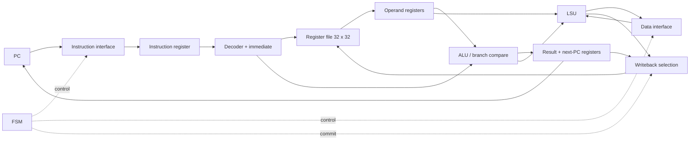
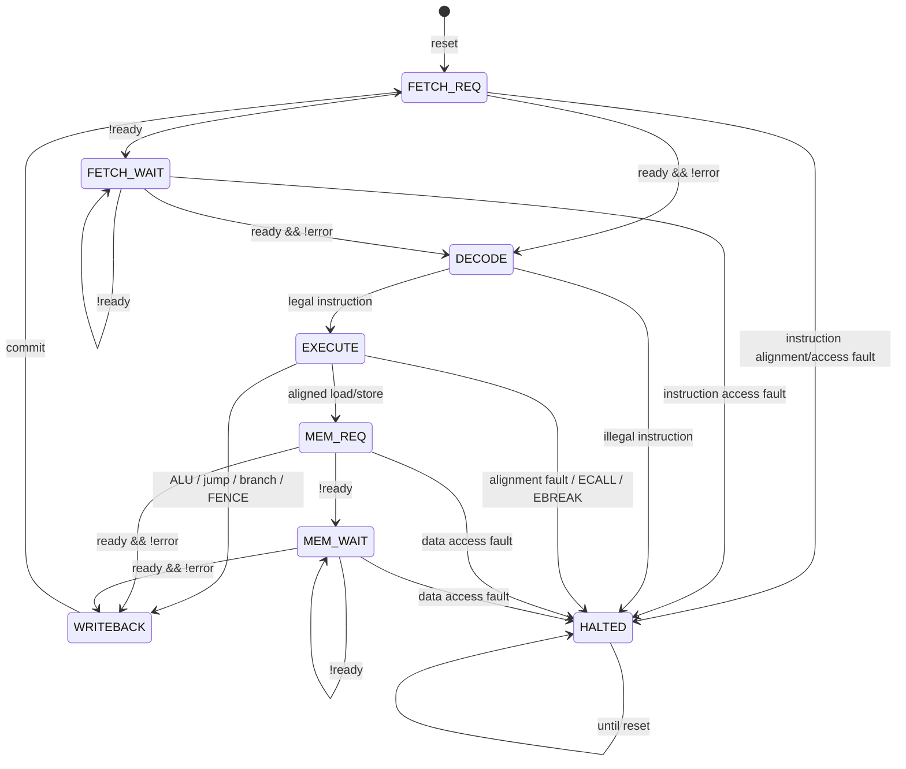

# Kiến trúc và phạm vi ISA

## Mô hình thực thi

Lõi là bộ xử lý **non-pipelined multi-cycle**: mỗi thời điểm chỉ có một lệnh đang thực thi. Một lệnh đi qua các pha fetch, decode, execute, truy cập bộ nhớ nếu cần và writeback. Độ trễ instruction/data memory có thể thay đổi; FSM chỉ tiến khi giao dịch hiện tại đã hoàn tất.

PC giữ địa chỉ của lệnh hiện tại cho đến cạnh clock kết thúc `WRITEBACK`. Giá trị PC tiếp theo được tính trước trong pha execute và chỉ được commit khi lệnh hoàn tất. Lệnh gây lỗi không ghi register file và không retire. Truy cập load/store sai alignment bị chặn trước khi phát request.

Các ranh giới decoder, ALU, register file và LSU độc lập với giao thức bộ nhớ. Thiết kế này tạo điểm phân chia tự nhiên để bổ sung thanh ghi pipeline; bản hiện tại chưa có hazard detection, forwarding hay flush.

## Các lệnh hỗ trợ

| Nhóm | Lệnh | Quy tắc chính |
|---|---|---|
| R-type | ADD, SUB, SLL, SLT, SLTU, XOR, SRL, SRA, OR, AND | Kiểm tra đúng funct3/funct7; chỉ lấy 5 bit thấp của toán hạng dịch |
| I-type | ADDI, SLTI, SLTIU, XORI, ORI, ANDI | Immediate 12-bit sign-extend; SLTIU so sánh unsigned sau khi sign-extend immediate |
| Shift immediate | SLLI, SRLI, SRAI | `shamt=inst[24:20]`; funct7 hợp lệ tương ứng `0000000`, `0000000`, `0100000` |
| Load | LB, LH, LW, LBU, LHU | Địa chỉ `rs1 + imm_i`; sign/zero extension theo lệnh |
| Store | SB, SH, SW | Địa chỉ `rs1 + imm_s`; byte-enable và wdata theo lane |
| Branch | BEQ, BNE, BLT, BGE, BLTU, BGEU | Target `pc + imm_b`; BLT/BGE signed, BLTU/BGEU unsigned |
| U-type | LUI, AUIPC | `imm_u`, `pc + imm_u` |
| Jump | JAL | Ghi `pc+4` và chuyển đến `pc+imm_j` |
| Jump register | JALR | Chỉ funct3=000; ghi `pc+4`; target `(rs1+imm_i) & 32'hFFFF_FFFE` |
| Ordering | FENCE | Chờ mọi giao dịch cũ hoàn tất bằng cấu trúc thực thi tuần tự |
| Environment | ECALL, EBREAK | Giải mã chính xác và dừng bằng sự kiện riêng |

Mọi phép cộng/trừ địa chỉ và ALU có kết quả 32-bit, tràn theo modulo `2^32`; không tạo arithmetic-overflow exception. SRA/SRAI sử dụng dịch phải số học, bảo toàn dấu. SLT/SLTI và BLT/BGE dùng biểu diễn bù hai signed; các biến thể có hậu tố U dùng unsigned.

Immediate được dựng từ encoding chuẩn:

| Loại | Giá trị 32-bit |
|---|---|
| I | `{{20{inst[31]}}, inst[31:20]}` |
| S | `{{20{inst[31]}}, inst[31:25], inst[11:7]}` |
| B | `{{19{inst[31]}}, inst[31], inst[7], inst[30:25], inst[11:8], 1'b0}` |
| U | `{inst[31:12], 12'b0}` |
| J | `{{11{inst[31]}}, inst[31], inst[19:12], inst[20], inst[30:21], 1'b0}` |

`x0` luôn đọc bằng 0. Mọi yêu cầu ghi `rd=0` bị bỏ qua, kể cả ghi link của JAL/JALR hoặc kết quả load. Load có `rd=0` vẫn phát giao dịch và vẫn có thể gây lỗi truy cập.

`IALIGN=32` do không hỗ trợ C. JALR xóa bit 0 trước khi kiểm tra alignment; target có bit 1 bằng 1 vẫn là lỗi. Branch chỉ kiểm tra target alignment khi điều kiện branch đúng. Branch không taken không gây lỗi chỉ vì target giả định sai alignment.

### FENCE và SYSTEM

Mọi encoding opcode MISC-MEM với funct3=000 được xử lý theo quy tắc FENCE của phiên bản này. Các trường rd/rs1 và các biến thể fm/pred/succ không làm giảm bảo đảm thứ tự: lõi luôn hoàn tất tuần tự mọi giao dịch. Các trường dành trước được bỏ qua để tương thích với quy tắc base ISA. Encoding FENCE.I có funct3=001 là illegal.

FENCE chỉ tương đương NOP khi toàn bộ đường đi bộ nhớ giữ nguyên thứ tự và `ready` phản ánh mức hoàn tất đủ để bảo đảm thứ tự đó. Nếu adapter báo sớm khi chỉ đưa store vào hàng đợi, hoặc hệ thống có cache, nhiều miền quan sát hay posted write, phải thiết kế thêm cơ chế fence/drain trước khi sử dụng lõi với hệ thống đó.

SYSTEM chỉ chấp nhận hai từ lệnh chính xác: `32'h0000_0073` (ECALL), `32'h0010_0073` (EBREAK). Không giải mã gần đúng theo riêng funct12; các trường rs1/rd/funct3 sai hoặc các lệnh CSR/privileged đều là illegal.

## FSM

ECALL/EBREAK được phát hiện chính xác khi decode và chuyển sang HALTED trong EXECUTE. Chúng dừng trước writeback và không retire.

`FETCH_REQ` và `FETCH_WAIT` cùng giữ `imem_req=1`; chuyển giữa hai trạng thái không tạo thêm giao dịch. Quy tắc tương tự áp dụng cho `MEM_REQ/MEM_WAIT`. Nếu slave trả `ready=1` ngay trong chu kỳ đầu, lõi nhận kết quả ngay và bỏ qua WAIT. Khi stall, các thanh ghi transaction giữ nguyên địa chỉ, loại truy cập, byte-enable và dữ liệu ghi.

Chỉ `WRITEBACK` cho phép ghi register file và xuất retirement. Vì trạng thái này kéo dài đúng một chu kỳ, stall bộ nhớ không tạo lần ghi register hay retirement lặp lại. Store chỉ tạo side effect tại handshake data memory; sau đó writeback hoàn tất luồng điều khiển.

## Chẩn đoán và dừng

Các đầu ra `halted`, `fault_valid`, `fault_cause`, `fault_pc`, `fault_tval`, `event_ecall`, `event_ebreak` được giữ đến reset. `event_ecall` và `event_ebreak` là cờ trạng thái sticky, không phải pulse một chu kỳ. Chỉ reset đưa lõi ra khỏi `HALTED`.

| cause | Ý nghĩa | `fault_tval` |
|---:|---|---|
| 0 | Instruction address misaligned | Target sai alignment, hoặc RESET_PC sai alignment |
| 1 | Instruction access fault | Địa chỉ fetch |
| 2 | Illegal instruction | Từ lệnh 32-bit |
| 3 | EBREAK | 0 |
| 4 | Load address misaligned | Effective byte address |
| 5 | Load access fault | Effective byte address |
| 6 | Store address misaligned | Effective byte address |
| 7 | Store access fault | Effective byte address |
| 11 | ECALL | 0 |

`fault_pc` là PC của lệnh gây lỗi. Với jump/branch gây lỗi target alignment, đây là địa chỉ lệnh jump/branch, không phải địa chỉ target. Với fetch fault, đây là địa chỉ fetch thất bại. ECALL/EBREAK cũng đặt `fault_valid=1` cùng với cờ sự kiện tương ứng.

Các số cause mượn quy ước RISC-V để thuận tiện tích hợp và quan sát. Chúng không phải CSR `mcause`, và cause 11 không có nghĩa lõi đã triển khai machine mode. Không có vector trap, stack exception, privilege transition, `mret` hay cơ chế tiếp tục sau lỗi.

## Retirement

`retire_valid` đánh dấu chu kỳ WRITEBACK; monitor lấy mẫu tại cạnh lên clock. `retire_pc`, `retire_inst` mô tả lệnh vừa hoàn tất; `retire_rd_we`, `retire_rd`, `retire_wdata` mô tả lần ghi thanh ghi nếu có. `retire_rd_we=0` với store, branch, FENCE hoặc đích x0. Giá trị rd/wdata không có ý nghĩa kiến trúc khi `retire_rd_we=0`.

Một lệnh gây lỗi hoặc ECALL/EBREAK không phát retirement. Giao diện này phục vụ scoreboard và quan sát tiến trình; nó chưa phải giao diện RVFI đầy đủ để gắn trực tiếp với riscv-formal.
